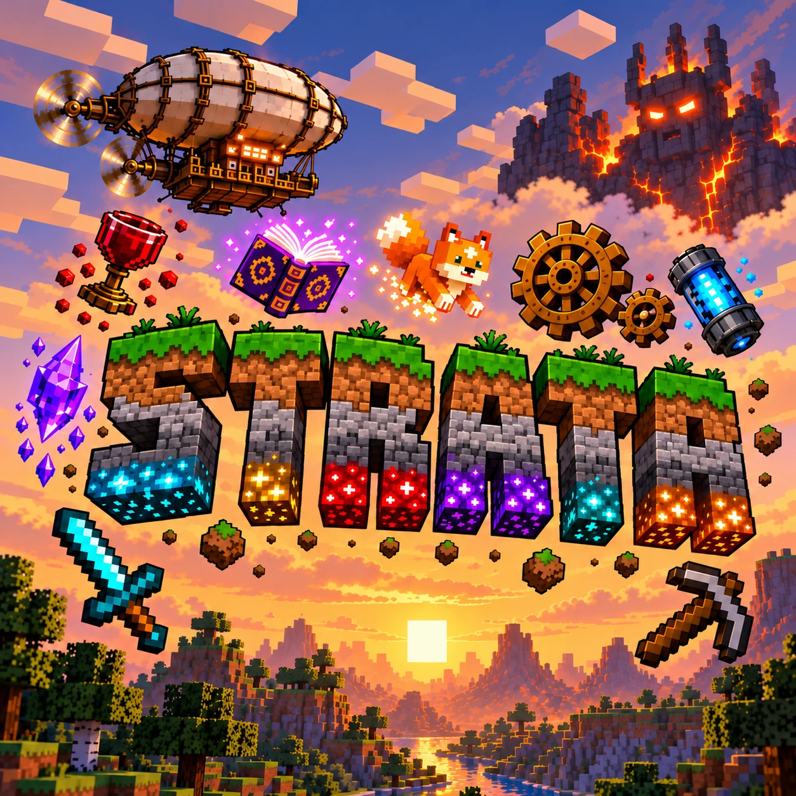

<p align="center">
  
</p>

<h1 align="center">Strata</h1>
<p align="center"><b>Build. Fly. Explore.</b><br>
A big kitchen-sink Minecraft modpack for a small group of friends.</p>

<p align="center">
  Minecraft 1.21.1 · NeoForge 21.1.264 · about 440 mods and libraries · managed with <a href="https://packwiz.infra.link/">packwiz</a>
</p>

---

## What is Strata?

Strata is a large modpack built around three ways to play, plus a cozy side:

| Path | What you do | Headline mods |
|---|---|---|
| **Tech** | Machines, trains, real airships you build block by block, factories and power grids | Create + add-ons, Create Aeronautics, Mekanism, AE2, Immersive Engineering, Oritech, Ad Astra, Draconic Evolution |
| **Magic** | Design your own spells, rituals, spirits and vampires | Ars Nouveau (the hub), Iron's Spells 'n Spellbooks, Occultism, Vampirism, plus bridges that tie them together |
| **Exploration** | New dimensions, dungeons, structures and boss fights | L_Ender's Cataclysm, Twilight Forest, Ice and Fire, Apotheosis, YUNG's, Tectonic + Regions Unexplored worldgen |
| **Cozy** | Farming, cooking, pets, decorating, colonies | Farmer's Delight and friends, Inventory Pets, MineColonies, Macaw's, Chipped, Quark |

A 38-chapter **quest book** (FTB Quests) walks you through all of it. Start with *Welcome to Strata*: nothing is locked, so jump to whatever looks fun.

## Strata's own worlds

Besides the usual dimensions, Strata adds three of its own:

- **The Hollow**: an opt-in horror dimension. Every horror mob in the pack lives only here. It's scary but fair: no one-shots, and every threat has a warning and a counter. Its Hollow Embers unlock some of the best gear and magic. ([design](docs/hollow-design.md))
- **The Abyssal Plain**: a fully underwater dimension with no surface. You arrive in a Lifepod; the sea always wins (broken blocks flood), and a boss ladder leads down to the Leviathan. Its Abyssal Pearls are the endgame currency. ([design](docs/abyssal-plain-design.md))
- **The Kakuto Region**: Pokémon (Cobblemon) live in their own world, reached through a portal you build. Wild Pokémon don't spawn anywhere else, and gyms are spread across the region.

## House rules

Strata is built around travel and earning your power, so a few things work differently:

- **Teleporting is limited.** Everyone gets one `/home` (`/sethome` to set it, 10-second cooldown). There's no `/back`, `/rtp` or `/tpa`. Waystones cost XP: more for long trips, extra across dimensions. You can *earn* teleporting later (Mekanism teleporters, Ars Nouveau warps, blink spells).
- **Flight takes effort.** Every way to fly takes real work to get (boss materials, late-game tiers, a tamed dragon) or costs something to run (fuel, power, mana, food, stamina).
- **Difficulty is per player.** Pick your own Apotheosis World Tier (Ctrl+T) once you unlock more. Bosses keep their designed strength.
- **Late tiers are boss-gated.** Nuclear power, top storage, the best rockets and the strongest magic need boss drops, Hollow Embers or Abyssal Pearls ([gate map](docs/gate-map.md)).
- **Death is forgiving.** A friend can revive you while you bleed out (PlayerRevive). If nobody does, your items wait in a grave (Corail Tombstone), and you respawn with a Grave's Key that takes you back to it once.

## Playing

The full guide is in **[docs/JOINING.md](docs/JOINING.md)**. Short version:

1. Install the free [Modrinth App](https://modrinth.com/app) and sign in with your Minecraft account.
2. Download the newest `Strata-<version>.mrpack` from [Releases](https://github.com/Darin-Barth/strata/releases/latest).
3. In the Modrinth App: **+ → From file** → pick the `.mrpack`.
4. Give it **10–12 GB of memory** (8 GB minimum) and add `-XX:+UseZGC -XX:+ZGenerational` to its Java arguments.
5. **Multiplayer → Add Server.** The server is whitelisted: ask Darin to be added.

**What you need:** a 64-bit PC with 16 GB of RAM or more (32 GB is comfortable), and a GPU that can run Sodium + Iris. Shaders, Distant Horizons and the other heavy visuals are optional and client-only. On a Mac, see the note in the joining guide.

**Updating:** the pack and the server must be on the same version. Import each new `.mrpack` as a new instance; [docs/JOINING.md](docs/JOINING.md#updating) explains how to keep your settings and keybinds. The default key layout is listed in [docs/keybinds.md](docs/keybinds.md).

## For maintainers

### Layout

| Path | What's there |
|---|---|
| `pack.toml`, `index.toml`, `mods/*.pw.toml` | The packwiz project. Each mod is a metadata file pointing at Modrinth (preferred) or CurseForge. Modrinth mods also carry their CurseForge file ID for the CurseForge export. |
| `config/` | Configs that ship with the pack. Per-player comfort configs (Distant Horizons, Camera Overhaul) are `preserve = true`, so updates don't overwrite players' own settings. |
| `config/ftbquests/quests/` | The quest book. **Generated**: edit `tools/quests/book/*.py`, never the `.snbt` files. |
| `kubejs/` | Startup, server and client scripts plus datapack overrides (`kubejs/data`). Several folders in `kubejs/data` are generated (see below). |
| `tools/` | Generators and checkers (Python). |
| `docs/` | Design docs, the mod tracker (`strata-mod-tracker.xlsx`) and the release queue. |
| `server/` | Local test-server files (not part of the pack). |
| `.github/workflows/curseforge.yml` | Builds the CurseForge zip for every GitHub release and can upload it. |

### Source of truth

- **[docs/design-doc.md](docs/design-doc.md)**: the rules (what's in, what's out, and why).
- **[docs/strata-mod-tracker.xlsx](docs/strata-mod-tracker.xlsx)** (sheet `Mods`): every mod with Keep / Maybe / Cut. Only **Keep** mods go in the pack.
- **[CLAUDE.md](CLAUDE.md)**: hard constraints and working notes (KubeJS gotchas, packwiz habits).

### Generators (re-run after the matching mod updates)

| Script | Builds |
|---|---|
| `tools/quests/build.py` | The quest book (from `tools/quests/book/*.py`), then checks every item, entity, structure and advancement ID against a registry dump |
| `tools/build_hollow.py` | The Hollow dimension, biome tags and spawn rules |
| `tools/build_abyssal_plain.py` | The Abyssal Plain dimension |
| `tools/build_pokeworld.py` | The Kakuto Region (Pokémon world) datapack |
| `tools/gates/build_tech.py`, `build_magic.py`, `build_gear.py` | Boss-gated recipe overrides ([gate map](docs/gate-map.md)) |
| `tools/build_balance.py` | Balance-patch recipe changes ([balance patch](docs/balance-patch.md)) |
| `tools/build_skill_trees.py` | Pufferfish's Skills trees ([rework](docs/skill-trees-rework.md)) |
| `tools/build_pet_loot.py` | Inventory Pets loot injection |

### Everyday commands

```bash
packwiz mr add <slug>
```

```bash
packwiz cf add <slug>
```

```bash
python -I tools/curseforge_ids.py
```

```bash
packwiz refresh
```

```bash
python -I tools/check_kubejs_const.py
```

Add mods with `packwiz mr add` (or `cf add` when a mod isn't on Modrinth), run `curseforge_ids.py` after adding or updating mods, and `packwiz refresh` after any manual edit. Commit `index.toml` and `pack.toml` with every pack change: the server follows `master`'s raw `pack.toml` and caches files by hash. Run the `const` checker before committing KubeJS scripts (Rhino breaks on `const` inside loops and blocks).

### Releases

Changes are queued on `master` and listed in **[docs/NEXT-UPDATE.md](docs/NEXT-UPDATE.md)**, then shipped together as one update. The release checklist is in that file. In short:

1. Bump `version` in `pack.toml` and on the title screen.
2. `curseforge_ids.py`, `packwiz refresh`, commit, push `master`.
3. `packwiz mr export`, then `gh release create v<version>` with the notes. The CurseForge Action attaches `Strata-<version>-curseforge.zip` (and uploads it when `CURSEFORGE_UPLOAD` is on).
4. Restart the server and check that every KubeJS script loaded with 0 errors.
5. Tell the group to import the new `.mrpack`.

### Server

The server runs the [itzg/minecraft-server](https://github.com/itzg/docker-minecraft-server) Docker image with `TYPE=NEOFORGE` and `PACKWIZ_URL` pointing at this repo's `pack.toml`, so a restart pulls the current `master`. Everything server-side must work headless. Worlds are pregenerated with Chunky.

## Credits

Strata is a curated list. All the real work belongs to the authors of the mods it includes, each under its own license; this repository only contains metadata pointing at their official downloads (Modrinth and CurseForge), plus Strata's own configs, scripts and data. Please support the mod authors.

Pack design by Darin, built with help from Claude Code.
